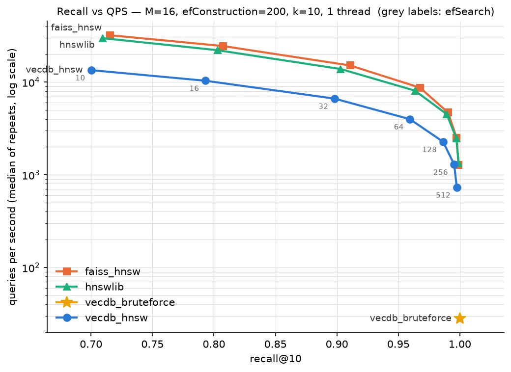

# vecdb

A vector search engine written from scratch in C++ (HNSW index), benchmarked against
FAISS/hnswlib, with a RAG-based system-design mock interviewer built on top.

**Status:** Phase 5 — benchmark harness and first SIFT1M results.

## Build and test

```sh
scripts/download_data.sh                 # siftsmall (10k vectors) for tests

cmake --preset asan && cmake --build --preset asan && ctest --preset asan        # tests, with sanitizers
cmake --preset release && cmake --build --preset release                         # -O2, for benchmarks
```

Never benchmark the `asan` build: sanitizers slow code down several times over.

## Layout

- `include/vecdb/`, `src/` — the library
- `tests/` — GoogleTest tests
- `bench/` — benchmark harness (`bench_hnsw`), FAISS/hnswlib comparison, plotting
- `scripts/` — dataset download, environment capture
- `data/` — datasets (git-ignored)

## Decision log

| # | Decision | Alternatives | Why |
|---|---|---|---|
| 1 | One squared-L2 distance kernel. `metric=cosine` means the engine normalizes vectors on insert and on query, then uses L2. | Separate L2 / inner-product / cosine kernels, as in hnswlib | On unit vectors `‖a−b‖² = 2 − 2cos θ`, so L2 and cosine rank identically: one kernel to test and optimize. Raw inner-product search (MIPS) is not needed here; add a kernel if that changes. |
| 2 | C++20 | C++17 | `std::span` lets functions take a view of a vector's floats without copying. |
| 3 | GoogleTest; system copy if installed, else a pinned download | Catch2 | Most widely used in industry; already installed. |
| 4 | Two CMake presets: `release` (`-O2`) and `asan` (debug + ASan + UBSan) | One build with flags toggled by hand | Makes it hard to benchmark a sanitized build by accident. |
| 5 | siftsmall (10k) for tests, SIFT1M for benchmarks; datasets git-ignored and fetched by script | Synthetic random vectors only | Standard datasets with published ground truth make results comparable. |
| 6 | Loader reads the whole file into one flat `std::vector<float>` | `vector<vector<float>>`; memory-mapping | Contiguous storage is cache-friendly (details to be measured in the brute-force phase). SIFT1M is ~500 MB, which fits in RAM, so mmap is unneeded complexity for now. |
| 7 | Brute-force siftsmall test at k = 100 compares distances, not ids | Compare result ids exactly against ground truth | Ties at equal distance are not broken in the same order as the ground-truth file. |
| 8 | `search_layer` tracks visited nodes with a zeroed `std::vector<bool>` per call | Reusable visited list (e.g. epoch counter, as in hnswlib) | Simplest correct version; can change in the future. |
| 9 | Neighbor selection: HNSW heuristic | Keep the M closest | On SIFT10K, recall@10 at efSearch = 10 rose from 0.913 to 0.933; at efSearch = 50, no change (0.996). Extra cost at build time only, to be measured in Phase 5. |

| 10 | Benchmark times every query on its own (`steady_clock`); QPS = queries / whole-loop time; p50/p99 by nearest rank; median of 5 repeats | Time only the whole loop; interpolated percentiles; mean of repeats | Per-query times give the latency distribution, not just an average. Nearest rank always reports a latency that actually happened. The median ignores one noisy repeat. min/max QPS show the spread. |
| 11 | Python baselines call the library once per query, like the C++ loop | One batched call for all queries | Batched calls amortize call overhead and measure something different. The per-query Python/binding cost is measured and reported instead (see Limitations). |
| 12 | `peak_mem_mb` = the process's VmHWM after the build; one engine per process; brute force runs before the HNSW build | Measure index bytes directly | VmHWM is the OS's own number and needs no per-engine accounting. It includes the loaded dataset (~0.5 GB for SIFT1M), the same for every engine, so compare differences between engines, not absolute values. |

## Benchmark results

SIFT1M (1M base × 128-d, 10K queries), k = 10, M = 16, efConstruction = 200, seed 42, **1 thread**.
Intel Core Ultra 9 185H laptop on AC power; every engine pinned to CPU 2 (a 5.1 GHz P-core) with
`taskset`; `powersave` governor (not changed). Engines ran one after another, not in parallel. Ours:
`g++ -O2 -DNDEBUG`, no `-march`. FAISS 1.16.0 (pip, AVX2) and hnswlib 0.8.0 (conda-forge, SSE only),
Python 3.14. Full machine/toolchain record: [`results/env.txt`](results/env.txt). Raw data:
`results/*.csv`. QPS = median of 5 repeats; the min–max QPS spread was at most 4.1% of the median in any row.



| efSearch | vecdb recall | vecdb QPS | vecdb p50 / p99 µs | FAISS recall | FAISS QPS | hnswlib recall | hnswlib QPS |
|---:|---:|---:|---:|---:|---:|---:|---:|
| 10 | 0.7003 | 13,472 | 73 / 120 | 0.7157 | 32,061 | 0.7097 | 29,820 |
| 16 | 0.7930 | 10,361 | 95 / 151 | 0.8075 | 24,513 | 0.8029 | 22,131 |
| 32 | 0.8981 | 6,641 | 152 / 220 | 0.9108 | 15,133 | 0.9031 | 13,857 |
| 64 | 0.9594 | 3,983 | 259 / 337 | 0.9675 | 8,721 | 0.9635 | 8,092 |
| 128 | 0.9864 | 2,272 | 458 / 582 | 0.9904 | 4,704 | 0.9893 | 4,518 |
| 256 | 0.9954 | 1,289 | 809 / 1047 | 0.9974 | 2,499 | 0.9971 | 2,478 |
| 512 | 0.9975 | 732 | 1423 / 1905 | 0.9990 | 1,285 | 0.9989 | 1,346 |

| | vecdb | FAISS | hnswlib |
|---|---:|---:|---:|
| Build time (1M inserts, 1 thread) | 571 s | 308 s | 310 s |
| Peak RSS after build (includes the ~0.5 GB dataset) | 1,168 MiB | 1,189 MiB | 1,274 MiB |
| Python per-call overhead in its latency (p50, this SIFT1M run; `results/*.log`) | — | 3.0 µs | 1.4 µs |

Brute force (ours, exact, first 500 queries): 28 QPS, p50 35.5 ms,
p99 38.0 ms, peak RSS 501 MiB (data only).

What this shows:
- **Speed:** at the same efSearch, ours is 1.8–2.4× slower than FAISS and hnswlib. FAISS's numbers
  include about 3 µs of Python overhead per query that ours doesn't pay, so the real gap is slightly
  *larger* than the table shows.
- **Recall:** at the same efSearch, our recall is slightly lower (0.700 vs 0.716 / 0.710 at ef = 10;
  0.9975 vs 0.999 at ef = 512), so we also need a larger ef for the same recall.
- **Where our query time goes** (perf, ef = 128, pinned P-core, profile build;
  [`results/perf_query.txt`](results/perf_query.txt)): `squared_l2` 87.8% of cycles, `search_layer`
  7.0%, `neighbors` 3.4%, libc 1.4%. Zeroing the visited bitmap (decision #8) and per-call allocations
  can only be in `search_layer` or libc, so their direct cost is at most 8.4%. They can't explain a 2× gap.
- **Inside `squared_l2`:** GCC does vectorize the subtract and multiply, 4 floats at a time
  (`subps`/`mulps`). Without `-ffast-math` it can't reorder the float sum, so every iteration adds the
  four lanes into one accumulator with four dependent scalar `addss`: about a quarter of the function's
  samples. About 73% of its samples land on the two vector loads: the kernel mostly waits on memory
  (each call reads a 512-byte base vector from a random row), not on arithmetic. This fits hnswlib's
  SSE-only build being within about 10% of FAISS's AVX2 build: SIMD width is not the main lever.
  Not measured yet: distance computations per query for each engine (graph quality), and the
  libraries' prefetching of upcoming vectors.
- **Vs brute force:** at ef = 128 (recall 0.986), HNSW answers about 80× more queries per second than
  exact search.
- **Build:** ours takes about 1.85× as long. Decision #9's open question, how much the heuristic costs
  at build time, is still not measured separately: the build profile
  ([`results/perf_build.txt`](results/perf_build.txt)) has the same shape (`squared_l2` 87.5%), and the
  heuristic's distance calls are counted inside `squared_l2`, not in `select_neighbors` (0.24%).

### How to reproduce

```sh
scripts/download_data.sh sift                        # SIFT1M into data/sift/
cmake --preset release && cmake --build --preset release

# Python baselines: binary wheels only, in a venv
uv venv --python 3.14 .venv
uv pip install --python .venv/bin/python --only-binary :all: -r bench/requirements.txt
# hnswlib has no wheels on PyPI (source only), so it comes prebuilt from conda-forge
micromamba create -y -p "$PWD/.conda-hnswlib" -c conda-forge --override-channels python hnswlib numpy

# Optional, for steadier numbers: performance governor, and pin to one core
sudo cpupower frequency-set -g performance
taskset -c 2 build/release/bench_hnsw --out results/vecdb.csv     # defaults: M=16, efC=200, seed 42, k=10
taskset -c 2 .venv/bin/python bench/compare.py --engine faiss   --out results/faiss_hnsw.csv
taskset -c 2 .conda-hnswlib/bin/python bench/compare.py --engine hnswlib --out results/hnswlib.csv
.venv/bin/python bench/plot.py results               # results/recall_qps.png
scripts/env.sh                                       # results/env.txt: CPU, kernel, compiler, flags, Python versions
```

Method (identical for every engine, single-threaded): loading is not timed. Build once, then for
each efSearch in 10,16,32,64,128,256,512: one untimed pass over all 10K queries for recall@10, then
100 untimed warm-up queries, then 5 timed repeats over all 10K queries. Brute force times the first
500 queries. `bench_hnsw --help` lists the flags; `--data-dir data/siftsmall` gives a quick smoke run.
Each log's `data:` line records the CPUs the process was allowed to run on (`cpus 2` under
`taskset -c 2`). The current `results/*.log` files predate this line.

## Limitations

- Loader assumes a little-endian machine.
- Loader reads the entire file into memory.
- Benchmarks: the engines don't use the same SIMD level. FAISS (pip wheel) loads its AVX2 build at
  runtime (`faiss.get_compile_options()` → `OPTIMIZE DD AVX2`). conda-forge's hnswlib 0.8.0 binary has
  no AVX instructions at all (objdump: SSE `xmm` registers only, zero `ymm`/`zmm`), because hnswlib
  chooses its kernels at compile time and conda-forge builds for generic x86-64. Ours is `-O2` with
  no `-march`. A gap measures algorithm *plus* implementation, not the algorithm alone.
- Benchmarks: the Python baselines pay a fixed per-call cost that C++ doesn't (interpreter, binding
  conversion, result arrays). `compare.py` measures it as the latency of a search on a k-vector index
  (p50, this machine: FAISS 3.3 µs and hnswlib 1.4 µs on the siftsmall smoke run; 3.0 µs and 1.4 µs on the SIFT1M run in the table above. The cost doesn't depend on the dataset, so the FAISS gap is run-to-run noise). At low efSearch that's a large share of
  latency, so it favors our engine there.
- Benchmarks: FAISS has no seed parameter, so its graph can't be seeded like ours and hnswlib's.
- Benchmarks: the C++ per-query timer adds two `steady_clock::now()` calls (tens of ns) to every
  latency and to the QPS loop.
